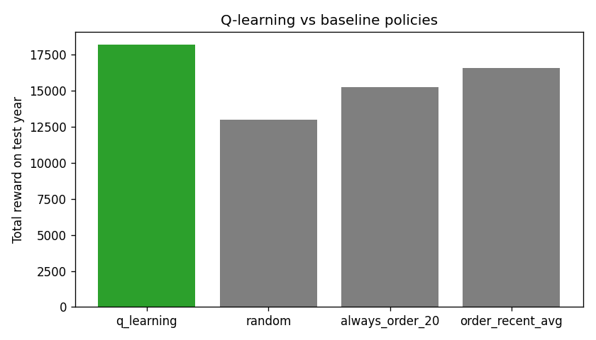
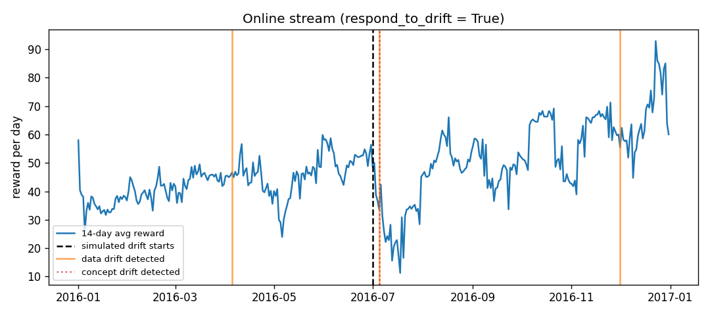
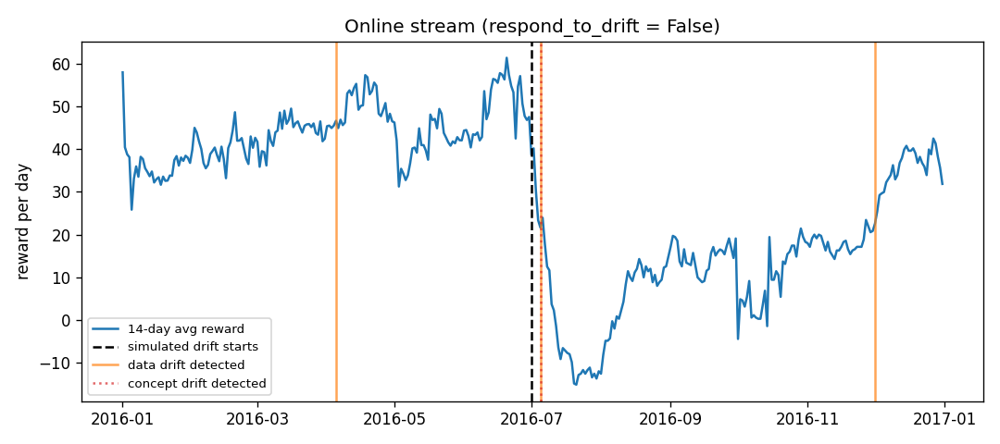

# Inventory Restocking Agent

A small reinforcement learning project: a Q-learning agent that decides how much
stock a shop should reorder each day. The whole thing runs as a DVC pipeline, so
anyone can pull the data and get the same results.

On top of the basic agent, there's an online learning stage (using River) that
watches for changes in demand and retrains the agent when it spots one. There's
also an optional Feast feature store setup.

## The problem

Every day a shop has to decide how many units to order, and every choice has a
cost:

- order too much and you pay to store the leftovers
- order too little and you lose sales
- every order costs money up front

The goal is to find a balance between those three.

## The data

I used store 1, item 1 from Kaggle's *Store Item Demand Forecasting Challenge*.
That's 1,826 days of sales from 2013 to 2017. If you don't have a Kaggle account,
`tools/get_data.py` can generate a synthetic version instead.

The data is split by date (never shuffled):

| Years | Used for |
|---|---|
| 2013–2015 | Training |
| 2016 | Online learning stream |
| 2017 | Final test |

To test how the agent handles change, demand in the 2016 stream is doubled from
July 1 onward (`drift_factor: 2.0` in `params.yaml`). The 2017 test data is left
as is.

## How the agent works

It's plain tabular Q-learning with ε-greedy exploration.

- **What it sees (state):** how much stock is on hand (8 levels), the day of the
  week (7), and whether demand is going up, down or flat (3). That's 168 states
  in total.
- **What it can do (actions):** order 0, 10, 20 or 40 units. Orders arrive
  overnight.
- **How it's scored (reward):** `5·sold − 2·ordered − 0.3·leftover − 2·unmet`
- **How it learns:** `Q(s,a) ← Q(s,a) + α[r + γ·max Q(s',a') − Q(s,a)]` with
  α = 0.1, γ = 0.95, trained for 600 episodes.

## What's in the repo

```
├── data/raw/sales.csv(.dvc)   raw sales data (tracked by DVC)
├── data/processed/            train / stream / test splits (tracked by DVC)
├── src/                       pipeline code: prepare, env, agent, train,
│                              evaluate, online_drift, feast_serve, utils
├── feature_repo/              Feast setup (optional)
├── tools/get_data.py          downloads or generates data/raw/sales.csv
├── tests/smoke_test.py        quick sanity checks
├── models/q_table.json        the trained agent (tracked by DVC)
├── metrics/                   JSON results and plot data
├── results/                   charts
└── params.yaml, dvc.yaml, dvc.lock, requirements.txt
```

## The pipeline

```
sales.csv.dvc → prepare → train → evaluate
                   └──────────┴──→ online_drift
```

| Stage | Takes | Produces |
|---|---|---|
| prepare | sales.csv | train, stream and test parquet files |
| train | train.parquet | q_table.json and the training curve |
| evaluate | q_table, test.parquet | eval.json, policy_comparison.png |
| online_drift | q_table, stream.parquet | drift.json, online_drift.png |

All the settings each stage uses live in `params.yaml`.

## Running it yourself

You'll need Python 3.11. The commands below are for Windows PowerShell.

**1. Clone the repo and install everything**

```powershell
git clone https://github.com/Az-main/Q-learning-MLSD-Project.git
cd Q-learning-MLSD-Project
py -3.11 -m venv .venv
.\.venv\Scripts\Activate.ps1
python -m pip install -r requirements.txt
```

**2. Add your DagsHub login**

The data and model are stored on DagsHub. Tell DVC who you are, using your
DagsHub username and an access token:

```powershell
dvc remote modify origin --local auth basic
dvc remote modify origin --local user YOUR_DAGSHUB_USERNAME
dvc remote modify origin --local password YOUR_DAGSHUB_TOKEN
```

This saves your login to `.dvc/config.local`. Git ignores that file, so your
token stays on your machine. Don't commit it or share it.

**3. Download the data and model**

```powershell
dvc pull
```

**4. Run and check**

```powershell
dvc status                  # should say everything is up to date
dvc repro                   # re-runs any stage that changed
dvc dag                     # shows the pipeline
dvc metrics show            # prints the results
dvc plots show              # builds the charts
python tests/smoke_test.py  # quick sanity check
```

## Working on it together

Before you start, grab the latest code and data:

```powershell
git pull
dvc pull
```

When you've changed something, re-run the pipeline and push everything:

```powershell
dvc repro
dvc push
git add .
git commit -m "Short note on what changed"
git push
```

If more than one person is working at the same time, use separate branches.
That way you won't overwrite each other's work, and changes can be reviewed
before they're merged.

## Results

Here's how the agent did on 2017, compared with three simple strategies:

| Strategy | Total reward | Service level | Stockout days | Avg leftover |
|---|---|---|---|---|
| **Q-learning agent** | **18,197** | 0.86 | 0.47 | 3.9 |
| Order the recent average | 16,589 | 0.89 | 0.34 | 26.5 |
| Always order 20 | 15,258 | 0.87 | 0.38 | 27.8 |
| Order at random | 12,980 | 0.81 | 0.27 | 27.3 |

The agent earns the highest total reward by keeping the shelf lean. It has
about 4 units left over each night, compared with about 27 for the other
strategies. It runs short a bit more often, but because storage costs money,
that trade-off pays off.

I also checked what happens if the agent ignores the future (γ = 0). It ends up
never ordering anything: total reward −16,054, and only 0.2% of demand gets met.



### When demand suddenly doubles

The online stage spotted the jump in demand 4 days after it happened. I ran it
twice, once letting the agent retrain when it spots the change and once
without:

| | Retraining on | Retraining off |
|---|---:|---:|
| Avg daily reward before the change | 44.07 | 43.84 |
| Avg daily reward after the change | 51.51 | 13.66 |
| Total reward over 2016 | 17,498.2 | 10,493.5 |
| Times it retrained | 3 | 0 |

Before the change, both runs score almost the same. After it, the version that
retrains earns nearly four times as much per day. Retraining is turned on by
default (`drift.respond: true` in `params.yaml`).

**Retraining on**



**Retraining off**


